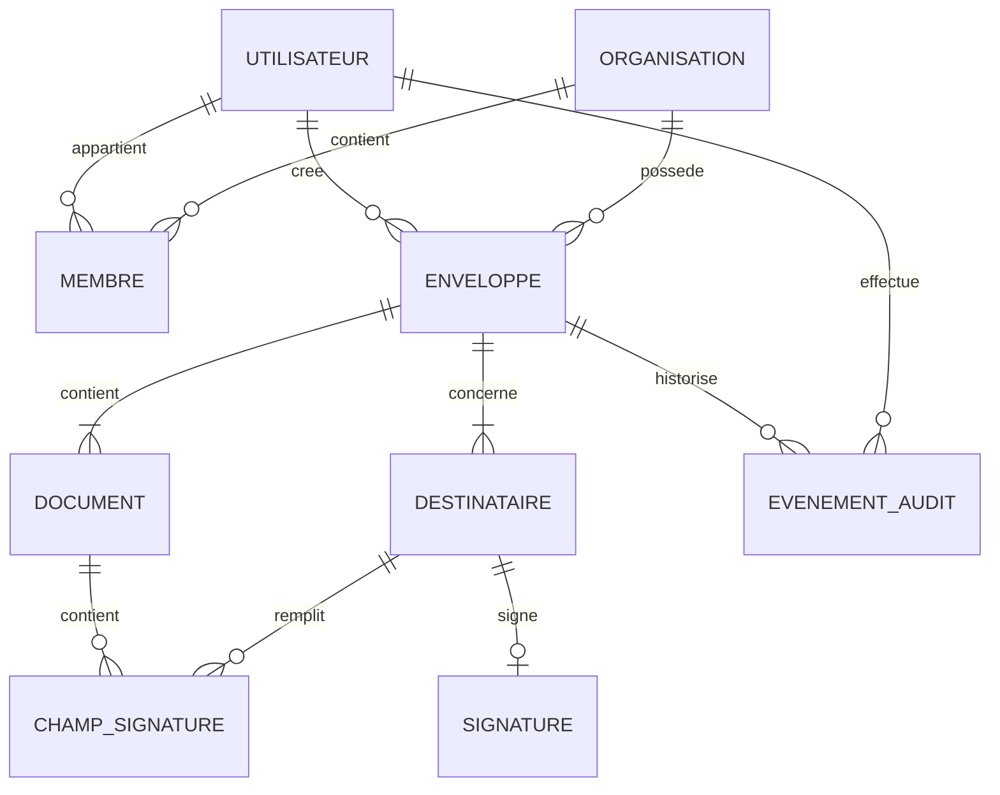

# MCD — Signeo

Ce document décrit le modèle conceptuel de données de Signeo, une plateforme de signature électronique inspirée des parcours de DocuSign.

## Objectif métier

Une **enveloppe** représente un processus complet de signature. Elle regroupe un ou plusieurs documents, les destinataires, les champs à remplir, le statut du processus et son historique d'audit.

## Entités

### UTILISATEUR

- `id_utilisateur`
- `nom`
- `email`
- `mot_de_passe`
- `date_creation`

Un mot de passe doit être stocké uniquement sous forme hachée.

### ORGANISATION

- `id_organisation`
- `nom`
- `date_creation`

Une organisation représente un espace de travail ou une entreprise.

### MEMBRE

- `id_membre`
- `role`
- `date_adhesion`

MEMBRE est l'association entre UTILISATEUR et ORGANISATION. Le rôle peut être `OWNER`, `ADMIN` ou `MEMBER`.

### ENVELOPPE

- `id_enveloppe`
- `titre`
- `statut`
- `date_creation`
- `date_envoi`
- `date_expiration`

Statuts possibles : `DRAFT`, `SENT`, `VIEWED`, `PARTIALLY_SIGNED`, `COMPLETED`, `DECLINED`, `VOIDED`, `EXPIRED`.

### DOCUMENT

- `id_document`
- `nom_fichier`
- `chemin_fichier`
- `type_mime`
- `taille`
- `empreinte`
- `date_import`

Le fichier PDF doit être conservé dans un stockage de fichiers. La base conserve ses métadonnées et son emplacement.

### DESTINATAIRE

- `id_destinataire`
- `nom`
- `email`
- `role`
- `ordre_signature`
- `statut`

Un destinataire peut être signataire, observateur ou approbateur.

### CHAMP_SIGNATURE

- `id_champ`
- `type`
- `page`
- `position_x`
- `position_y`
- `largeur`
- `hauteur`
- `valeur`
- `obligatoire`

Types possibles : `SIGNATURE`, `INITIALS`, `DATE`, `TEXT`, `CHECKBOX`.

### SIGNATURE

- `id_signature`
- `date_signature`
- `adresse_ip`
- `empreinte_document`
- `methode`

Une signature est liée à un destinataire et prouve l'action de signature sur une enveloppe.

### EVENEMENT_AUDIT

- `id_evenement`
- `type_evenement`
- `date_evenement`
- `adresse_ip`
- `details`

Les événements d'audit sont append-only : ils ne doivent pas être supprimés ni modifiés.

## Associations et cardinalités



## Lecture des cardinalités

- Un utilisateur peut appartenir à plusieurs organisations.
- Une organisation peut avoir plusieurs membres.
- Un utilisateur peut créer plusieurs enveloppes.
- Une enveloppe appartient à une organisation.
- Une enveloppe contient au moins un document.
- Une enveloppe possède un ou plusieurs destinataires.
- Un document peut contenir plusieurs champs.
- Un champ est destiné à un destinataire.
- Un destinataire peut signer une enveloppe au maximum une fois.
- Une enveloppe possède plusieurs événements d'audit.
- Un événement d'audit peut être lié à un utilisateur ou à un signataire externe.

## Règles métier

1. Une enveloppe doit contenir au moins un document.
2. Une enveloppe doit avoir au moins un destinataire.
3. L'e-mail d'un utilisateur doit être unique.
4. Un même destinataire peut apparaître dans plusieurs enveloppes.
5. Un champ appartient à un document et à un destinataire.
6. Une signature ne peut être créée que pour un destinataire autorisé.
7. Une enveloppe terminée ne peut plus être modifiée.
8. Les événements d'audit ne doivent jamais être supprimés.
9. Le document final doit être associé à l'enveloppe terminée.
10. Les mots de passe ne sont jamais stockés en clair.

## Exemple métier

```text
Organisation : Agence Signeo
└── Enveloppe : Contrat freelance
    ├── Document : contrat-freelance.pdf
    ├── Destinataire : Camille Martin
    ├── Destinataire : Signeo SAS
    ├── Champ : signature Camille
    ├── Champ : date Camille
    └── Historique :
        ├── enveloppe créée
        ├── invitation envoyée
        ├── document consulté
        ├── document signé
        └── enveloppe terminée
```

## Ordre conseillé pour l'implémentation

1. `users` — déjà utilisé par l'authentification.
2. `organizations` et `memberships`.
3. `documents`.
4. `envelopes`.
5. `recipients`.
6. `signature_fields`.
7. `signatures`.
8. `audit_events`.

Au début du projet, TypeORM peut synchroniser les tables en développement. En production, il faudra remplacer `synchronize` par des migrations.

